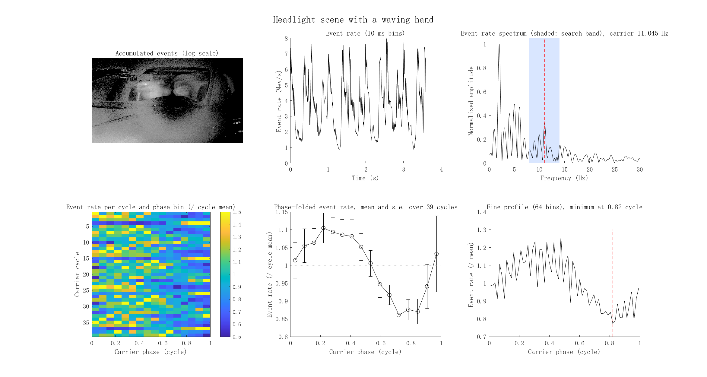
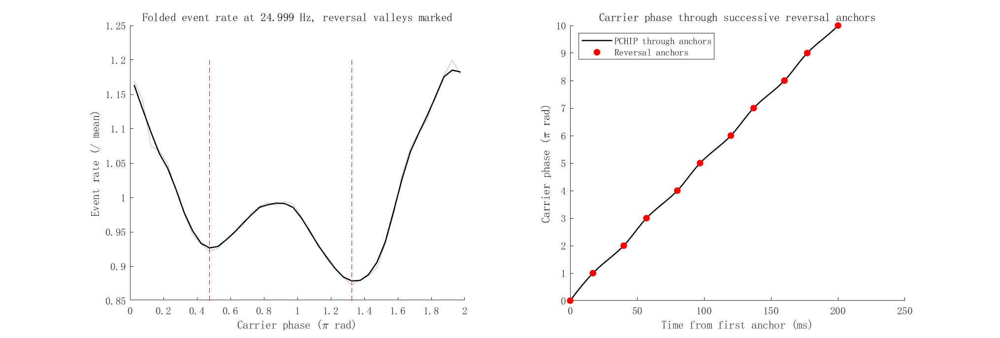

# RCEI: event data and MATLAB demo

Data and MATLAB code accompanying *Self-referenced optical carrier enables
joint static and dynamic event imaging*.

This repository contains event recordings and a MATLAB example of
event-derived carrier timing. Part 1 estimates the carrier frequency of two
headlight recordings and folds them into carrier cycles, reproducing the
frequency cross-check in the paper. Part 2 detects the event-rate valleys at
the reversals of the reciprocal sweep, uses them as phase anchors and
interpolates the carrier phase through them (main-text Fig. 3,
Supplementary Section 2.6 and Eq. S15).

## Quick start

MATLAB R2021b or later is required. No additional toolboxes are needed.

Download the repository using **Code > Download ZIP** and extract it, or clone
it with Git. Keep the folder structure intact. In MATLAB, open the repository
folder and run:

```matlab
run_demo
```

The program creates `results/` and writes four PNG figures, three MAT result
files, `summary.csv` and `validation.csv`. It checks the results against
`expected/expected_values.csv`; a successful run reports `20/20 numerical
checks passed`. Reference figures and a numerical summary are in `expected/`.

### Part 1: carrier frequency and phase folding

| Recording | Full-field frequency | Hand corridor excluded | Complete cycles |
|---|---:|---:|---:|
| Waving hand | 11.045 Hz | 11.052 Hz | 39 |
| No hand | 10.990 Hz | not used | 58 |

The analysis uses both event polarities, 1-ms event-rate bins, an 8–14 Hz
frequency search band and 16 phase bins. The phase coordinate is
`mod((t - t_first) * f, 1)`, with frequency estimated separately for each
recording. The 64-bin plot includes all recorded events; its dashed line
marks the minimum after circular three-bin smoothing.

### Part 2: reversal anchors of the reciprocal carrier

A 3-s window of the reciprocal-drive recording of the marker scene is
included. Hot pixels and the least active pixels are removed with
`rcei_pixel_filter`, and the carrier frequency is estimated within ±15% of the
25-Hz command. `rcei_reversal_anchors` folds the event rate into 40 phase bins,
with the phase origin at the phase of the event-rate line, and applies a
circular three-bin average. A local minimum is accepted as a reversal valley
when its prominence, measured against the lower of the two flanking maxima
within one third of a cycle, is at least 0.02, and minima closer than 0.25π
are merged. The two valleys give two anchors per carrier cycle. Successive
anchors are separated by π in phase, and the continuous phase is interpolated
through them with shape-preserving cubic Hermite interpolation (PCHIP), so
that unequal half-cycles are mapped onto equal phase intervals.

| Recording | Carrier frequency | Reversal valleys | Anchors |
|---|---:|---:|---:|
| Reciprocal drive, 3-s window | 24.999 Hz | 0.475π, 1.325π | 148 |

## Example output





## Data and files

All sequences were acquired with a Prophesee EVK4 camera (1280 × 720 pixels,
16-mm lens), with a 3-arcmin wedge prism producing the reciprocal optical
carrier. The headlight recordings view a parked vehicle under headlight
glare. The reciprocal-drive window views the marker scene used for the drive
comparison in main-text Fig. 3 and covers 4.0–7.0 s of that recording.

| Folder | Contents | Events | Duration |
|---|---|---:|---:|
| `data/headlight_dynamic/` | Waving-hand recording, four MAT parts | 13,256,812 | 3.5997 s |
| `data/headlight_static/` | No-hand recording, three MAT parts | 8,736,357 | 5.3320 s |
| `data/drive_reciprocal/` | Reciprocal-drive window, nine MAT parts | 28,254,999 | 3.0000 s |
| `data/annotations/` | Manual palm-centre annotations | — | — |
| `src/` | Loading, analysis, plotting and numerical checks | — | — |
| `core/` | Executable frequency and phase functions | — | — |
| `expected/` | Expected values and reference figures | — | — |

Keep all parts of each recording. Each MAT file contains:

| Variable | Meaning |
|---|---|
| `x`, `y` | Zero-based pixel coordinates, `uint16` |
| `p` | Polarity: 1 ON, 0 OFF, `uint8` |
| `t_us` | Microseconds from the first retained event (headlight) or from the window start (reciprocal drive), `uint32` |
| `meta` | Recording description, part index and total event count |

`data/annotations/palm_center_manual.csv` contains 21 palm positions at
0.18-s intervals. The frequency cross-check excludes the union of ellipses
with semiaxes 82 and 86 pixels around these positions, plus a 20-pixel image
border. The annotations are used for this cross-check only.

The events were decoded from EVT 3.0 RAW recordings. For the dynamic
recording, 142 decoded events preceding the retained start time were excluded.
Coordinates, polarity and timestamps of the retained events are preserved;
timestamps are rebased to the first retained event. The reciprocal-drive
window contains all events of the recording between 4.0 and 7.0 s, without
filtering. Checksums for the data parts and the annotation file are listed in
`data/SHA256SUMS.txt`.

Original recording checksums:

```text
3453c4876ad929fe85648251b1b0d18cd435e5d7770ffdb697b6d956cc0e9b41  output01.raw
e0dd550d9fb8084869a0ecc1b509ba46e0d30687764464e8befd75df337b64c0  recording_2026-05-20_21-08-57.raw
```

## Implementation

`run_demo.m` and `src/` provide the loader, pixel filter, reversal-anchor
detection and phase interpolation (`rcei_reversal_anchors.m`), analysis,
plotting and numerical checks as MATLAB source. The two estimators in `core/` are executable P-files
generated with MATLAB R2021b. Their interfaces are:

```matlab
[fHz, info] = rcei_carrier_frequency(t_s, 'Band', [8 14], 'BinWidth', 1e-3)
[phase, cycleIdx, binIdx, info] = rcei_carrier_phase(t_s, fHz, 'NumBins', 16)
```

The frequency estimator also accepts `'EventMask', mask` to select events.
Cycle indices are one-based; events outside complete cycles have index zero.
Phase is expressed in cycles, in `[0, 1)`. Part 1 uses the fixed-frequency
phase folding of the headlight cycle analyses.

```matlab
[anchor, info] = rcei_reversal_anchors(t_s, fHz, 'NumBins', 40)
```

returns the valley phases and prominences, the anchor times and phases, and
the anchor-referenced phase of every event. The valley rule and its settings
are documented in the function header.

## Updates and maintenance

We will continue to organize supporting research materials for public release
and maintain this repository. Further updates will be made available here as
the materials are prepared.

## Citation and license

Please cite the manuscript title and this repository until the paper's
publication details are available.

See [LICENSE](LICENSE): data are distributed under CC BY 4.0, source files
under the MIT License, and the P-files under the demo-use terms stated there.
